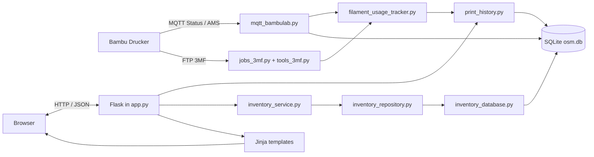
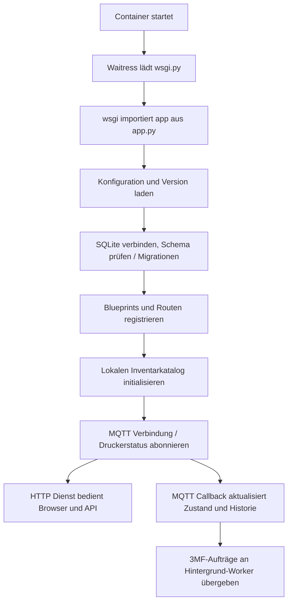
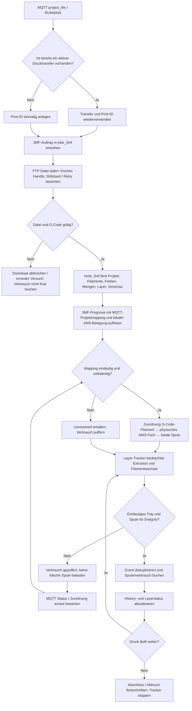
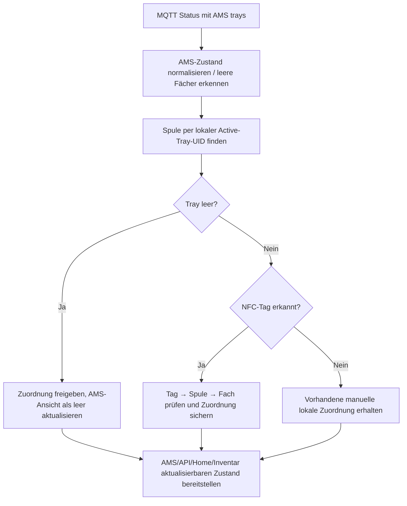
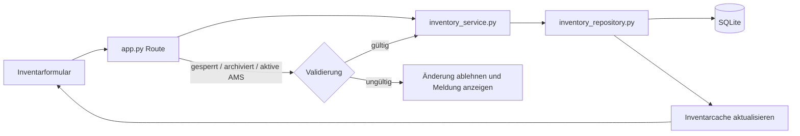
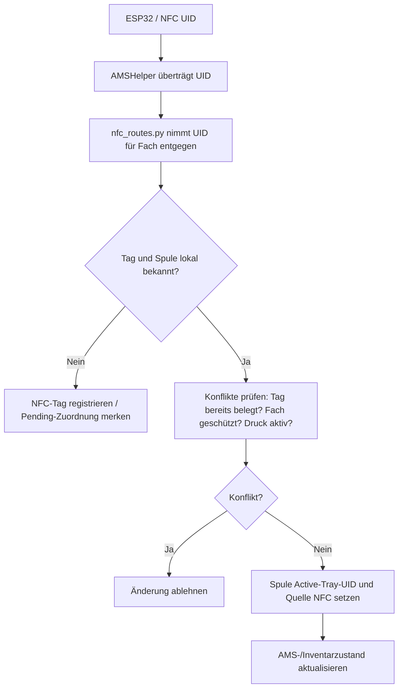
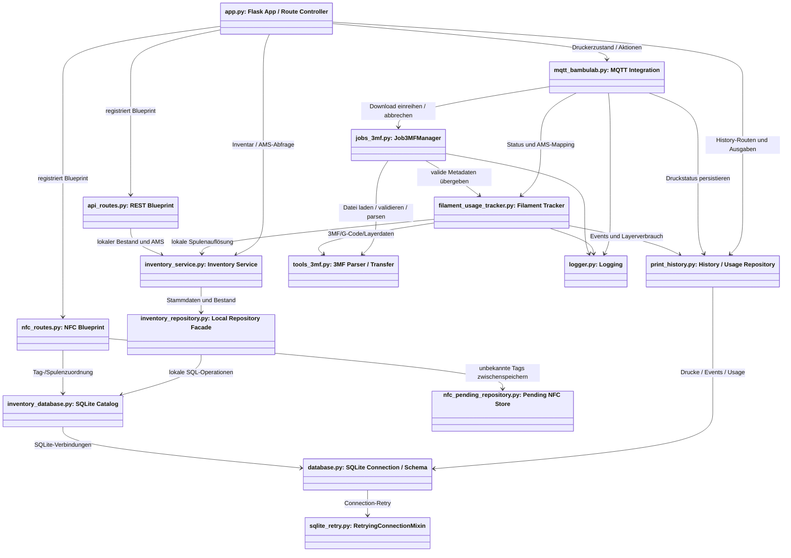
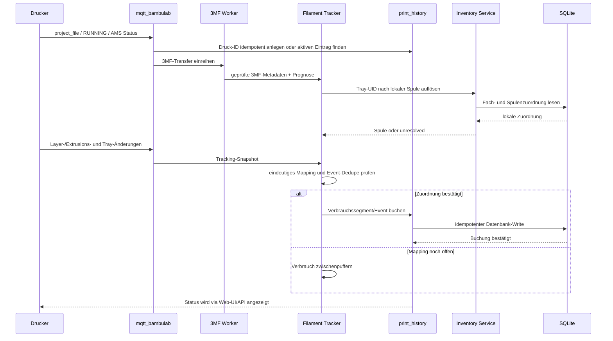

# m0BamboSpool – Ablauf- und Klassenplan

Stand: 05.11.2026. Diese Übersicht beschreibt den aktuellen Codebestand. Sie ist als Landkarte gedacht; für konkrete Details gilt der jeweilige Quelltext.

## 1. Systemgrenze

Die Anwendung läuft als Flask-/Waitress-Dienst im Docker-Container. SQLite ist der lokale Datenbestand und die führende Verwaltung für Filamente, Spulen, Farben, Materialien, NFC-Tags, Druckhistorie und Verbrauch. MQTT liefert den Drucker-/AMS-Zustand. 3MF/G-Code-Dateien liefern Projekt- und Verbrauchsprognosen. Der Browser rendert serverseitige Jinja-Vorlagen und fragt Live-Zustand bei Bedarf über HTTP ab.

## 2. Programmstart

`app.py` ist der Anwendungseinstieg und bindet die Routen und Dienste zusammen. `wsgi.py` exportiert das Flask-Objekt für den Server. `local_settings_routes.py`, `api_routes.py` und `nfc_routes.py` kapseln ausgewählte Routengruppen.

## 3. Druckauftrag: Erkennung bis History und Verbrauch

### Zuordnungsregeln

1. 3MF `slice_info.config` beschreibt logische Filament-IDs und erwartete Mengen. G-Code-Filamentindex ist nicht automatisch gleich dem AMS-Fach.
2. MQTT-Projektmapping und beobachtete `tray_tar`-Wechsel liefern die physische Fachzuordnung.
3. `inventory_service`/lokaler Katalog ordnet Fach-UID dem lokalen Spulenrecord zu. Die lokale AMS-Spulenbelegung ist die fachliche Quelle.
4. Farbe ist nur ein Plausibilitätsmerkmal. Sie ist nicht eindeutig, weil dieselbe Farbe mehrfach vorkommen kann.
5. Bei fehlender oder widersprüchlicher Evidenz bleibt die Zuordnung offen und Verbrauch wird zwischengespeichert.
6. Verbrauchsereignisse werden nach Druck, Layer und Filamentindex dedupliziert; erst bestätigte Ereignisse verändern den Spulenbestand.

## 4. Fachliche Hauptabläufe

### AMS-Status

### Inventaränderung

### NFC-Zuordnung

## 5. Module und Klassen / Abhängigkeiten

Das Projekt verwendet überwiegend Funktionsmodule statt einer großen Klassenhierarchie. Die wesentlichen Klassen sind die Worker- und SQLite-Verbindungsobjekte.

### Verantwortlichkeiten

| Modul | Verantwortung | Wesentliche Abhängigkeiten |
|---|---|---|
| `app.py` | Flask-Einstieg, UI-Routen, Zusammensetzen der Dienste | MQTT, History, Inventory, Blueprints, Templates |
| `mqtt_bambulab.py` | MQTT-Verbindung, normalisierter Drucker-/AMS-Zustand, Druckereignisse und Befehle | Tracker, 3MF-Worker, History, Inventory-Service |
| `jobs_3mf.py` | Single-Flight-Warteschlange, Transferstatus, Retry/Abbruch | `tools_3mf`, Logger |
| `tools_3mf.py` | 3MF/G-Code lesen, validieren, FTP/Dateiübertragung und Vorschauen | Dateisystem, ZIP/XML, Logger |
| `filament_usage_tracker.py` | Layer-/Extrusionsbeobachtung, Mapping, Pufferung, Buchung und Reconciliation | History, Inventory, 3MF-Tools |
| `print_history.py` | Druckhistorie, Status, Spool-Usage und Verbrauchsevents persistieren/abfragen | `database.py`, lokale Filament-/Spulendaten |
| `inventory_service.py` | Fachlogik: Active-Tray, AMS-UID, Cache und Sperrregeln | Inventory-Repository, MQTT, History |
| `inventory_repository.py` | Schmale lokale Datenzugriffsfassade | `inventory_database.py` |
| `inventory_database.py` | Lokale Stammdaten und Spulenbestände | `database.py` |
| `database.py` | SQLite-Verbindungen, Schema und Migrationen | `sqlite_retry.py`, Konfiguration |
| `api_routes.py` | Versionierte JSON-API | MQTT, Inventory-Service |
| `nfc_routes.py` | NFC-Endpunkte, UID-Konfliktprüfung, Zuordnung | MQTT, Inventory-DB, Pending-Store |
| `local_settings_routes.py` | Lokale Drucker- und Anwendungseinstellungen | Konfiguration / DB |
| `ui_formatting.py`, `translations.py` | Zeitzonen-/Formatierungs- und Übersetzungshilfen | UI/Templates |

## 6. Zentrale Zustände und Bedingungen

| Zustand / Bedingung | Folge |
|---|---|
| Druck `PREPARE` | History-Datensatz/Metadaten vorbereiten; Filamentverbrauch puffern, bis Modell-Ausführung bestätigt ist |
| Druck `RUNNING` | Layertracking aktiv; Verbrauch nur anhand bestätigter, eindeutiger Ereignisse buchen |
| Druck `PAUSE` | Status pausiert; Zuordnungen/Verbrauch bleiben am Druckauftrag gebunden |
| Druck `FINISH` | abgeschlossene History und bestätigte Buchungen festschreiben; Tracker beenden |
| `STOP`/`FAILED` | Abbruch-/Fehlerstatus klassifizieren; nicht bestätigte Daten nicht als bestätigten Verbrauch ausgeben |
| G-Code fehlt/ungültig | Druckdaten nicht final verwenden; Transfer erneut versuchen bzw. Verbrauch puffern |
| AMS-Fach eindeutig | logisches Filament an physisches Fach und lokale Spule binden |
| AMS-Fach mehrdeutig/unbekannt | kein Farb-Raten; Verbrauch bleibt ungeklärt/gepuffert |
| NFC-Tag unbekannt | Pending-Tag erfassen, damit eine spätere Zuordnung möglich ist |
| Spule archiviert oder AMS-/NFC-gebunden | erlaubte Änderungen durch Inventarregeln begrenzen; Löschung/Verlagerung blockieren |

## 7. Datenfluss der Verbrauchsbuchung

## 8. Einstiegspunkte zum Weiterlesen

- [Projektarchitektur](projektarchitektur.md)
- [Start und Betrieb](../START.md)
- [API-Referenz](../referenz/api.md)
- [NFC-Architektur](nfc.md)
- [Designentscheidungen](../../DESIGN.md)
